  

  
  
  

## ⚡ About

I turn marketing energy into campaigns, connections, and growth. 
My next training arc: building my own apps with Kotlin. 
I bring marketing and code together, and keep levelling up.

## 🔥 Power levels

Power levels as text

| Skill | Level | Label |
|---|---:|---|
| Affiliate relations | 90 | Publisher Power |
| Meta Ads | 85 | Campaign Charge |
| Conversion tracking | 85 | Signal Focus |
| SEO | 80 | Search Momentum |
| Kotlin | 60 | Builder Training |
| Jetpack Compose | 55 | Interface Practice |

## 🌀 Techniques

  ⚡ <a href="https://janardanpal007.github.io/FastDownloader-Download/"><b>FastDownloader</b></a> ·
  👻 <a href="https://janardanpal007.github.io/Ghostream/"><b>Ghostream</b></a> ·
  🪙 <a href="https://github.com/Janardanpal007/fintrack-app"><b>FinTrack</b></a> ·
  📄 <a href="https://github.com/Janardanpal007/proscan-doc-pdf"><b>ProScan</b></a> ·
  📱 <a href="https://github.com/Janardanpal007/mobile-handler"><b>Mobile Handler</b></a>

## 🗺️ Training arcs

| Arc | When | What happened |
|---|---|---|
| 🟦 **Builder Arc** | Ongoing | Indie app development with Kotlin, bringing marketing experience into my own products. |
| 🟨 **World Map Arc** | Dec 2025 | Attended Affiliate World Conference, Bangkok. |
| 🟧 **Campaign Surge** | Mar–Oct 2024 | Freelance Digital Marketing Consultant, Mobiqliq Global. Scaled ₹2 lakh+ quarterly Meta ad spend to 100,000 app installs; Meta Ads, social posts and blogs. |
| 🟧 **Growth Arc** | Jul 2021–now | Affiliate Marketing Manager, The Social Eye. Meta Pixel, Conversions API and conversion tracking; onboarding and managing publishers for iGaming/RMG campaigns. |
| ⬜ **Systems Arc** | 2017–2021 | Administrative Clerk, BBAU Lucknow. Maintained the department database and kept IT systems running. |
| ⬜ **Workshop Arc** | 2017 | Job Trainee, Tata Motors. |
| ⬜ **Foundation Arc** | 2013–2016 | BCom, Monad University. |

   
  <b>The next level starts with a connection.</b> 
  Open to hybrid and remote opportunities. <a href="https://linkedin.com/in/janardan-pal">Connect on LinkedIn</a>.

Artwork is original and AI-generated for this profile; the theme is a tribute to shonen-anime energy and isn't affiliated with any franchise.
