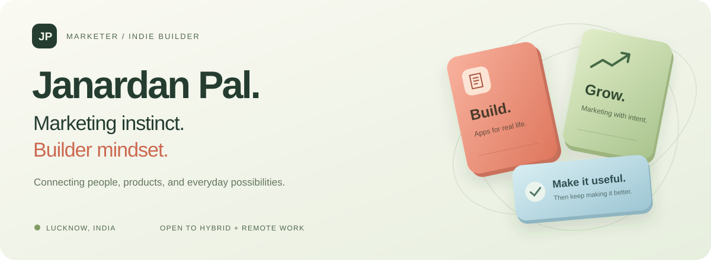

  

  

  
  
  

## 👋 About me

- 🧭 I work in **affiliate marketing** and build **apps for everyday tasks**.
- 📱 I ship Android apps in **Kotlin** and **Jetpack Compose**, plus a desktop download manager.
- 🎯 I care about useful products, thoughtful interfaces, and reaching the right audience.
- 📍 Based in **Lucknow, India** · open to hybrid and remote opportunities.
- 💬 Talk to me about apps, growth, affiliate programs, and conversion tracking.

## 🚀 My apps

<table>
<tr>
<td width="50%" valign="top">

### 📱 Mobile Handler
**One place for everyday phone tasks.**

Ad blocking, photo enhancing, document tools, scanning, notes, calculations, and phone care — with Sparky helping you find the right tool.

[Website](https://janardanpal007.github.io/mobile-handler/) · [Releases](https://github.com/Janardanpal007/mobile-handler/releases) · [Feedback](https://github.com/Janardanpal007/mobile-handler/issues)

</td>
<td width="50%" valign="top">

### 👻 Ghostream
**Browsing, reading, and downloading on Android.**

An Android browser with tabs, ad and tracker filtering, reader mode, and download management.

[Website](https://janardanpal007.github.io/Ghostream/) · [Releases](https://github.com/Janardanpal007/Ghostream/releases) · [Feedback](https://github.com/Janardanpal007/Ghostream/issues)

</td>
</tr>
<tr>
<td width="50%" valign="top">

### ⚡ FastDownloader
**Keep your downloads moving.**

Multi-connection downloads, pause and resume, queues, and browser integration for Android, Windows, macOS, and Linux.

[Website](https://janardanpal007.github.io/FastDownloader-Download/) · [Releases](https://github.com/Janardanpal007/FastDownloader-Download/releases) · [Feedback](https://github.com/Janardanpal007/FastDownloader-Download/issues)

</td>
<td width="50%" valign="top">

### 📄 ProScan · Doc, PDF
**Turn paper into something you can work with.**

Scan documents, convert files, annotate and sign PDFs, and organize pages on Android.

[Website](https://janardanpal007.github.io/proscan-doc-pdf/) · [Browser demo](https://janardanpal007.github.io/proscan-doc-pdf/app/) · [Feedback](https://github.com/Janardanpal007/proscan-doc-pdf/issues)

</td>
</tr>
<tr>
<td colspan="2" valign="top">

### 🪙 FinTrack
**A clearer view of your money.**

A private, local-only money tracker for Android. Nothing leaves your phone.

[Website](https://janardanpal007.github.io/fintrack-app/) · [Releases](https://github.com/Janardanpal007/fintrack-app/releases) · [Feedback](https://github.com/Janardanpal007/fintrack-app/issues)

</td>
</tr>
</table>

## 🛠️ What I build with

  

  
  
  
  
  

| Marketing & growth | Building & learning |
| :--- | :--- |
| Affiliate and publisher relationships | Kotlin and Android app development |
| Meta Ads and campaign management | Jetpack Compose interfaces |
| Meta Pixel, Conversions API, and conversion tracking | Everyday utility and document workflows |
| SEO, content, and audience development | Product presentation and user experience |

## 📊 GitHub activity

  

## 🧭 My journey

<b>Experience, education, and milestones</b>

 

| When | Experience |
| :--- | :--- |
| Ongoing | **Indie app development** — building products and learning Kotlin. |
| Jul 2021–present | **Affiliate Marketing Manager · The Social Eye** — publisher onboarding, campaign relationships, Meta Pixel, Conversions API, and conversion tracking. |
| Mar–Oct 2024 | **Freelance Digital Marketing Consultant · Mobiqliq Global** — Meta Ads, social posts, and blog content. |
| 2017–2021 | **Administrative Clerk · BBAU, Lucknow** — department database and IT systems support. |
| 2017 | **Job Trainee · Tata Motors**. |
| 2013–2016 | **BCom · Monad University**. |
| Dec 2025 | Attended **Affiliate World Conference, Bangkok**. |

<b>Want to contribute or report a problem?</b>

 

1. Choose the relevant project above and read its README.
2. Check existing issues before opening a new one.
3. For bugs, include the app version, device or operating system, steps, and expected versus actual behavior.
4. For ideas, describe the problem and who the improvement would help.
5. For code changes, check whether the repository contains source code and follow its contribution guidance.

Keep passwords, API keys, financial information, and other private details out of public issues.

<b>The creative side</b>

 

I enjoy anime-inspired energy and playful product characters, including Sparky. Here's the original artwork from my profile:

Original AI-generated profile artwork; not affiliated with any anime franchise.

---

  <b>Have a useful idea, a growth challenge, or a role in mind?</b> 
  Tell me what you're working on and how we could collaborate.  
  <a href="https://www.linkedin.com/in/janardan-pal/"><b>Connect on LinkedIn ↗</b></a>
  &nbsp; · &nbsp;
  <a href="https://discord.dog/704385778809307226"><b>Say hello on Discord ↗</b></a>

